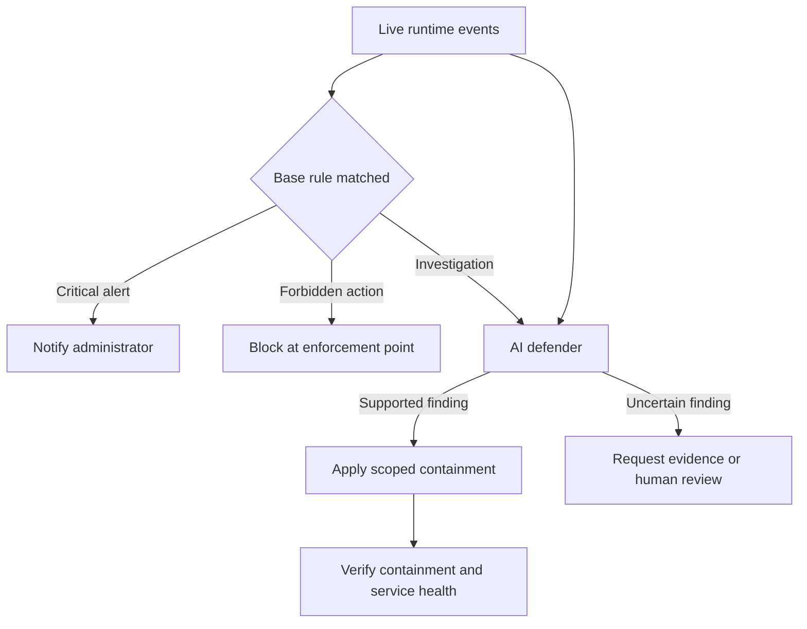

# Agentic Runtime Defense

**Research proposal · Draft v0.2 · 27 November 2026**  
**Author** · Amenallah Barkaoui

Agentic Runtime Defense is a proposed system for detecting, investigating and containing cyberattacks **while they are in progress**. It is designed for environments where automated attackers can act faster than a human team can investigate. The defender follows live activity across applications, identities, hosts and network connections. Its decisions depend on observed behavior, whether the attacker is human or automated.

## The three layers

| Layer | What it does during an incident |
| --- | --- |
| **1. Base Rules** | Rules watch for security-relevant events and combinations of signals. A match immediately triggers the AI defender. Where an inline control exists, it can block an explicitly forbidden action immediately. A critical match also notifies the administrator. |
| **2. Agentic Defender** | The agent connects the triggering event to the affected session, process or workload. It checks whether the evidence supports an active attack, legitimate activity or an inconclusive finding. It can request a scoped response, such as restricting one session or isolating one workload. A policy controller checks the scope and duration before acting. The administrator receives the finding and the outcome. |
| **3. Runtime Evidence** | Continuous monitoring links relevant frontend interactions, API requests, selected function calls, process activity, identity changes and outbound connections. Server-side identifiers connect events across these sources. Code fingerprints flag unexpected changes. The agent receives the evidence needed for the case while credentials and private payloads stay outside its context. |

## A live example

One worker in a three-worker API service tries to reach a destination that policy forbids. The network control blocks the connection. Seconds later, identity telemetry reports an unexpected privilege change associated with the same worker. The defender checks the deployment record and activity on the other workers. If the evidence supports compromise, it requests isolation of the affected worker and sends the administrator the evidence behind that decision. An independent enforcement check tests isolation, and a health probe checks whether the API still serves legitimate traffic. If verification is unavailable, the incident stays open.

## What this research tests

Several alerts can arrive together. Two individually reasonable isolation decisions could take two of the three workers offline. The proposed controller gives concurrent incidents a **shared limit on automatic isolation**. If the service requires two healthy workers, the controller can reserve one automatic worker isolation. Further alerts can trigger a narrower session restriction or escalation to the administrator. Explicit blocks on forbidden operations continue. A response deadline triggers escalation when the defender lacks enough evidence to act.

**Research question.** Can the AI defender shorten the time to verified containment under the same service-availability constraints as a fixed rule-to-action response?

## Evaluation and prior work

Compare both approaches with identical telemetry, rules and permitted actions. Test legitimate maintenance, an isolated incident, concurrent alerts and loss of a sensor. Measure time from the first observable signal to independently verified containment, incidents still uncontained at the cutoff, healthy workloads isolated and legitimate requests that failed. Equal speed and disruption from the fixed response would count against an added benefit from the AI.

Falco Talon maps runtime alerts to actions. Microsoft Defender XDR correlates signals and can automatically contain assets. ADEPTS studied adaptive containment while preserving service. This proposal builds on those precedents and asks how an AI defender performs when simultaneous incidents compete for a limited amount of safe isolation. The design and evaluation plan are available for review. Performance remains unmeasured. [Falco Talon](https://falco-talon.github.io/docs/) · [Microsoft Defender XDR](https://learn.microsoft.com/en-us/defender-xdr/automatic-attack-disruption) · [ADEPTS research paper](https://engineering.purdue.edu/dcsl/publications/papers/2005/adepts_dsn05_cameraready.pdf)