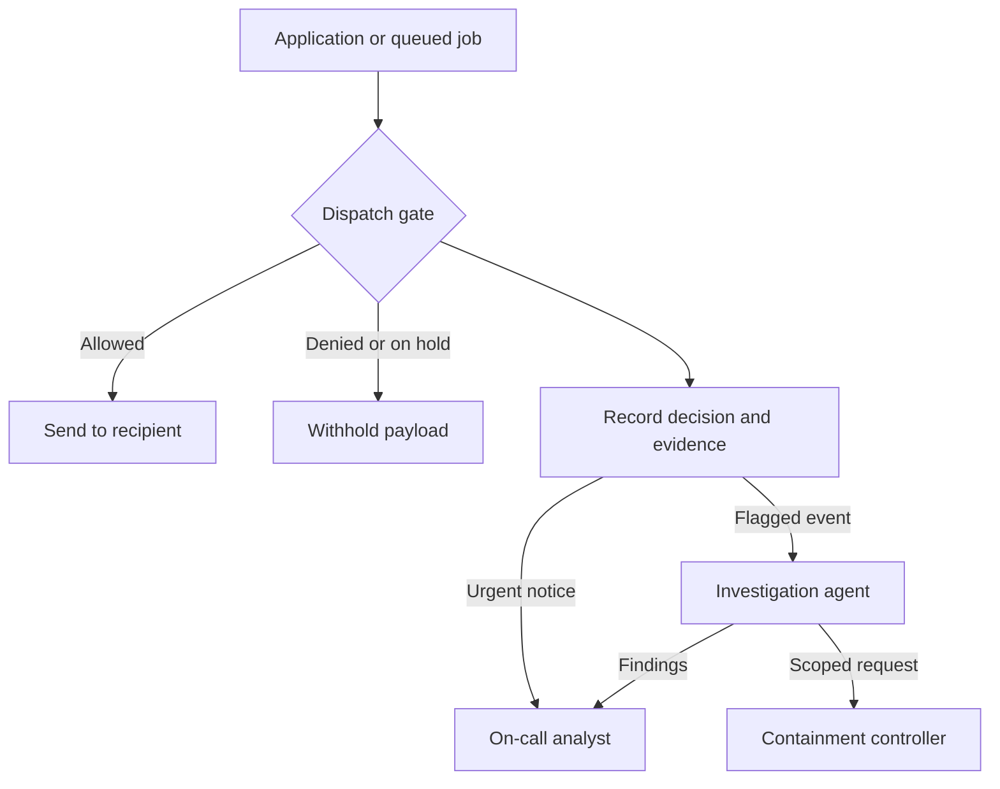

# Agentic Runtime Defense

**Research proposal · Draft v0.1 · 26 November 2026**  
**Author** · Amenallah Barkaoui

A billing service can run an approved build, use an approved email provider and still send an invoice to the wrong customer. The decision depends on who owns the invoice, who will receive it and which permission is valid at the moment of dispatch. A checksum and a list of approved domains leave those questions open.

This proposal places a policy check where a web application is about to release sensitive data. A separate investigation agent follows the evidence from the original request to the outbound operation. The first study covers invoice exports, including exports that wait in a background queue. This version documents the design and an evaluation plan. Its performance and effectiveness are open research questions.

> **Research question.** Given the same alerts, policies and audit records, does access to an investigation agent help an analyst identify the correct cause of an incident sooner, while preserving diagnostic accuracy?

## The three layers

| Layer | Responsibility |
| --- | --- |
| **1. Base rules** | The dispatch gate checks the actor, the owner of the data, the actual recipient and the current grant before releasing the first payload byte. A definite violation blocks the export. Missing authorization evidence puts it on hold. A permitted but unusual export can proceed and raise an alert. |
| **2. Investigation agent** | On a flagged event, the agent reads the relevant records, reconstructs what happened and cites the evidence for its finding. It can request a time-limited pause of the affected export job. A separate controller validates the scope and duration. An analyst approves actions that would interrupt a shared service. |
| **3. Evidence collection** | The application, queue worker and dispatch gate record selected events under a server-issued operation ID. Trace links connect instrumented service calls. Browser events provide context. The gate obtains identity, ownership and recipient permissions from trusted server-side records. |

The on-call analyst receives urgent alerts as soon as the decision is recorded. The agent can attach its findings later. If the agent is offline, dispatch checks still run and flagged cases wait for investigation.

## Worked example

The following events are hypothetical. The invoice, recipient and operation IDs are synthetic.

| Moment | What happens to export `EXP-17` | Expected behavior |
| --- | --- | --- |
| The clerk queues the export | Tenant A owns invoice `INV-42`. Recipient `R-7` has an active grant. | Record the actor, tenant, invoice, recipient and grant references on the job. |
| The job is waiting | The billing administrator revokes the grant for `R-7`. The invoice, code and email provider are unchanged. | Record the grant change with its time and version. |
| The worker attempts dispatch | The gate resolves the actual recipient and checks the current grant. | Withhold the invoice before sending its contents. Record the reason and notify the on-call analyst. |
| The agent reviews the alert | The queue, revocation and denial records identify the same operation or grant. | Explain that the grant was revoked after queueing and before dispatch. Cite the three records. Leave unrelated billing jobs running. |

An authorized export that merely exceeds the usual daily volume provides a companion case. Its alert can be closed as benign when the records show that a pre-approved month-end billing run accounts for the volume. If the relevant evidence is missing, the agent reports an inconclusive finding.

## Draft interaction protocol

Each record below carries an event ID, a server timestamp, an operation ID and the issuing component. The operation ID survives queue handoffs and retries. Each dispatch attempt gets a distinct attempt ID. A separate grant-change event links back through the grant reference and revision. These identifiers support correlation. Authorization comes from the current grant evaluated at dispatch.

| Record and issuer | Required information | How it is used |
| --- | --- | --- |
| **Dispatch decision** · gate | Attempt ID, actor, owner tenant, resource and recipient references, grant reference and revision, rule ID, policy version, decision, reason and alert severity | The sending adapter requires an allow decision bound to this attempt, resource and recipient. A changed recipient or a held export requires a fresh decision. |
| **Dispatch outcome** · adapter | Attempt ID, outcome, payload byte count if known, downstream acknowledgement reference if available | Distinguish withheld, sent, acknowledged, partial and unknown outcomes. An acknowledgement establishes acceptance by the named downstream service. |
| **Investigation finding** · agent | Case ID, assessment, supporting event IDs and unresolved questions | Report a confirmed violation, a benign event or insufficient evidence. A blocked attempt and successful delivery are distinct findings. |
| **Containment action** · controller | Request ID, target job, action, expiry, authority and execution result | Validate the structured request against the action policy, deduplicate repeated requests and record whether the action took effect. The controller treats free text from alerts as evidence only. |

**Evidence integrity and privacy.** Release checks compare deployed code with a signed reference for the expected release. An unfamiliar digest prompts verification of the version and provenance. The application labels customer data using its schema and ownership records. Encryption and access controls protect the underlying contents. The audit store keeps opaque references, decisions and counts. Invoice bodies, credentials and raw session tokens stay out of the agent's context. The application can append audit events and has no permission to rewrite earlier ones. [Sigstore signature verification][sigstore] · [OWASP logging guidance][owasp-log]

## Evaluation plan

**Comparison.** Both study arms use the same dispatch policy, telemetry, alerts and underlying evidence. In one arm an analyst investigates the trace unaided. In the other an analyst also receives the agent's evidence-linked finding. A reference implementation could use OPA with Envoy at the dispatch boundary. The policy and its verified business inputs must be equivalent in both arms. [OPA–Envoy integration][opa]

**Cases.** Generate synthetic examples of an ordinary permitted export, an unusual but approved batch, a wrong recipient at an approved provider, revocation while queued, a temporarily unavailable agent and a handoff with a missing acknowledgement. Write the answer key before analyst review. Keep it and the independent receiver's measurements outside both review interfaces. For a missing acknowledgement, score *unknown* as correct when the evidence available to the analyst cannot establish delivery.

**Measures.**

- Measure time from alert visibility to the analyst's first **correct** causal diagnosis. Also report accuracy, inconclusive findings and cases still unresolved at a common observation cutoff.
- For protected exports, count payload bytes arriving at an independent test receiver and legitimate exports held or blocked. Compare those observations with the gate's record. Record dispatch latency at the 95th percentile with and without the additional audit instrumentation.
- Counterbalance the order of review and use matched case variants so an analyst sees each exact example once. Have a reviewer who does not know the study arm score diagnoses against the prewritten answer key.

The study covers exports routed through the instrumented gate. It assumes trustworthy grant records and a gate that controls the covered outbound path. Its findings would apply to that path and case set. A shorter investigation accompanied by more incorrect diagnoses would count against the hypothesis.

## Related work

| Prior work | Relationship to the proposal |
| --- | --- |
| Google Security Operations | Its playbooks can branch on an investigation agent's verdict and invoke containment. This proposal keeps the initial dispatch decision independent of the agent and measures the agent's contribution to diagnosis separately. [Agentic playbooks][google] |
| Wazuh | File integrity monitoring detects changes to monitored files, and Active Response can run a configured action for a matching alert. These are precedents for the base rules and release checks. [File integrity monitoring][wazuh-fim] · [Active Response][wazuh-ar] |
| OpenTelemetry | Context propagation links work across instrumented services. The proposed operation ID also follows a business operation through delayed jobs. [Context propagation][otel] |
| OWASP | Its transaction authorization guidance recommends a final authorization check before execution. Here that check binds an invoice to its current recipient grant. [Transaction authorization][owasp-auth] |
| C-FLAT, 2016 | This research demonstrates attestation of an embedded program's execution path. In this proposal, a release digest identifies an artifact version. The application trace supplies evidence about an individual export. [Paper at Aalto University][cflat] |

A follow-up experiment could give both groups the same agent and vary only whether the evidence includes explicit links between events. That comparison would isolate the value of linking the records across components.

[google]: https://docs.cloud.google.com/chronicle/docs/soar/respond/working-with-playbooks/agentic-automation2
[wazuh-fim]: https://documentation.wazuh.com/current/compliance/pci-dss/file-integrity-monitoring.html
[wazuh-ar]: https://documentation.wazuh.com/current/user-manual/capabilities/active-response/
[otel]: https://opentelemetry.io/docs/concepts/context-propagation/
[opa]: https://www.openpolicyagent.org/docs/envoy
[owasp-auth]: https://cheatsheetseries.owasp.org/cheatsheets/Transaction_Authorization_Cheat_Sheet.html
[owasp-log]: https://cheatsheetseries.owasp.org/cheatsheets/Logging_Cheat_Sheet.html
[sigstore]: https://docs.sigstore.dev/cosign/verifying/verify/
[cflat]: https://research.aalto.fi/en/publications/c-flat-control-flow-attestation-for-embedded-systems-software/